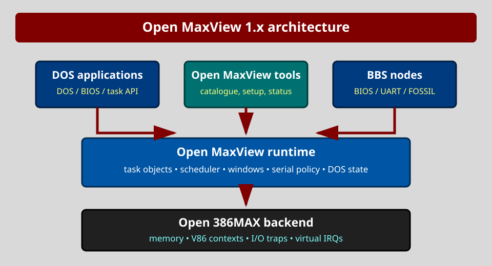

# Open MaxView help

This is the installed help book for Open MaxView. It describes Open MaxView's
own programs and files. Items marked **1.x target** are planned compatibility
work, not features of the current foreground-only milestone.

New users can follow `QUICK.TXT` for a single installation-to-first-launch
path before using this topic-oriented reference.

## Help index

* Starting and leaving Open MaxView
* Opening a program
* Adding, changing and removing programs
* Importing an existing DVP
* Automatic program detection
* Settings, memory and file services
* Keyboard reference and recovery
* Window and task commands (1.x target)
* Serial and BBS operation (1.x target)

## Starting and leaving

Run `MAXVIEW` from the installation directory or put that directory on
`PATH`. The launcher normally loads `MAXVTSR.COM` and `MAXVANSI.COM` when they
are absent, reads `MAXVIEW.CFG`, and displays the program catalogue.

Press Esc to leave. If confirmation is enabled, accept the dialog. Leaving the
launcher does not uninstall a resident component.

## Opening a program

Move with Up and Down and press Enter. When hotkeys are enabled, the red
letter beside an entry launches it directly. The current milestone waits for
the child to exit and then redraws the catalogue. A failed launch is recorded
in `MAXVIEW.LOG`.

The **1.x target** keeps several tasks alive. Its Open list will contain
configured programs; its Switch list will contain running tasks and identify
the task with keyboard focus.

## Maintaining the program catalogue

Run `MAXVAPP`. Insert creates an entry, Enter edits it, Delete requests
removal and F2 saves. A record contains a unique launch letter, title, DOS
command, optional working directory and conventional-memory range.

Removal changes only the catalogue and never deletes the program. Saving
keeps the previous catalogue as `MAXVIEW.BAK`.

## Importing and detecting programs

`MAXVDVP PROGRAM.DVP` validates and previews an existing DVP before importing
its launch fields. The source is never changed. Advanced serial, scheduler
and virtual-machine fields remain visible through `/LIST` and are retained in
the versioned catalogue profile for later 1.x enforcement.

`MAXVAUTO` compares filenames in the current directory and `PATH` with rules
in `MAXVAUTO.DAT`. `/R:directory` adds a recursive root. Detection never
executes an unknown file; review entries before applying them.

## Settings, memory and files

`MAXVSET` edits global launcher preferences. It exposes only settings already
honoured by the current implementation.

`MAXVMEM` reports DOS, EMS, XMS, VCPI, the resident API, its common-memory
pool and the Open 386MAX backend. `N/A` means the value cannot be obtained
safely. `MAXVMEM` is not a memory manager.

`MAXVFILE` browses directories and provides guarded copy, rename, directory
creation and deletion. Enter opens a directory, Backspace selects its parent,
F5 copies, F6 renames, F7 creates a directory and F8 requests deletion.

`MAXVANSI.COM` handles common ANSI cursor, erase and colour sequences sent
through the DOS fast-console interrupt. Direct video writes bypass it until
per-task video virtualisation exists.

## Keyboard reference

| Key | Meaning |
|---|---|
| Up, Down | Move the selection |
| Enter | Open, edit or confirm |
| Esc | Cancel or leave the current screen |
| F2 | Save in editors |
| F5 | Refresh, scan or copy according to the screen |
| Insert | Add a catalogue entry |
| Delete | Request removal of the selected entry |
| Backspace | Parent directory in the file browser |

Red letters identify direct commands. The gray pane lists keys valid on the
current screen.

## Recovery

Configuration writers create a `.NEW` file and preserve the preceding file as
`.BAK`. After an interrupted save, keep an external copy, select the newest
complete version and validate it with the matching `/CHECK` command.

## Window and task commands (1.x target)

The local 1.x interface will add these operations after Open 386MAX contexts
and per-task video state are available:

* Open starts a configured program in a new task.
* Switch changes keyboard focus without ending another task.
* Move and Resize change the viewport independently of logical screen size.
* Zoom toggles between a saved viewport and the full text screen.
* Scroll changes the visible origin of a larger logical screen.
* Hide removes a task from display without stopping it.
* Freeze suspends scheduling until explicitly resumed.
* Close requests orderly shutdown before offering forced termination.
* Tune adjusts foreground/background scheduling within safe limits.

These commands must preserve memory, DOS state, keyboard queues and serial
ownership. They will not be presented as working before those guarantees have
tests.

## Serial and BBS operation (1.x target)

A BBS node must receive data while another task has focus. It therefore needs
interrupt-driven serial service, background scheduling, explicit port
ownership and a non-swappable active context. Open MaxView will distinguish
BIOS serial, direct UART and FOSSIL programs. See `BBSGUIDE.TXT` for the
design, configuration and acceptance tests.

