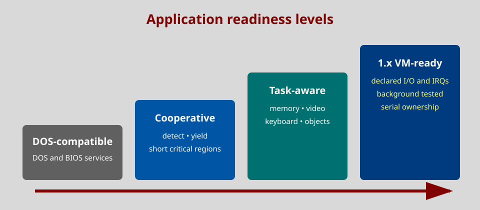

# Programming DOS applications for Open MaxView

This handbook explains how to make a DOS program cooperate with Open MaxView.
Examples target Open Watcom C in 16-bit real mode. The public declarations are
in `include/odqapi.h`; no NASM dependency is required.



## Compatibility levels

A program may be:

* **DOS-compatible**: uses DOS and BIOS services and runs in the current
  foreground launcher.
* **cooperative**: detects the resident API, yields during idle loops and uses
  short critical regions.
* **task-aware**: additionally uses documented memory, video, keyboard and
  task-object calls implemented by `MAXVTSR`.
* **1.x virtual-task ready**: declares direct video, I/O and serial needs and
  has been tested with isolated contexts and background scheduling.

Always retain an ordinary DOS fallback unless the program genuinely requires
the task API.

## Build environment

Compile for DOS with Open Watcom and link with JWlink from Open 386MAX. A
typical small-model command is:

```text
wcc -bt=dos -ms -0 -os -s -zq -w4 -i=include program.c
jwlink format dos name PROGRAM.EXE option stack=4096 file program.obj
```

The repository `GNUmakefile` contains complete library paths and reproducible
examples. Assembly modules use the embedded JWasm in 8086 mode.

## Detecting the environment

Use the standard presence call before any optional service:

```c
#include <dos.h>
#include <string.h>
#include "odqapi.h"

static int maxview_present(unsigned *version)
{
    union REGS inregs, outregs;
    memset(&inregs, 0, sizeof(inregs));
    inregs.x.ax = 0x2b01;
    inregs.x.cx = 0x4445;
    inregs.x.dx = 0x5351;
    int86(0x21, &inregs, &outregs);
    if (outregs.h.al == 0xff)
        return 0;
    *version = outregs.x.bx;
    return 1;
}
```

`BX=0250h` (2.80, minor in binary as DESQview reports it) identifies the compatible API level. Open MaxView-private feature
negotiation uses `ODQ_MUX_STATUS`, `ODQ_MUX_INFO`, `ODQ_MUX_CAPS2` and
`ODQ_MUX_CAPS3`. A portable application should prefer documented calls and
treat private bits as optional acceleration or diagnostics.

## Yielding instead of busy waiting

Call `PAUSE` when an idle loop has no immediate work:

```c
static void cooperative_pause(void)
{
    union REGS inregs, outregs;
    inregs.x.ax = ODQ_DVC_PAUSE;
    int86(0x15, &inregs, &outregs);
}
```

Recheck the program's condition after every return. A scheduler may wake a
task for input, a timer or another object. Do not assume a minimum sleep time.

## Critical regions

Use `BEGIN_CRITICAL` and `END_CRITICAL` around the smallest state update that
must not be sliced. Nesting is supported. Never surround user input, file I/O,
long calculations or an idle wait.

```c
inregs.x.ax = ODQ_DVC_BEGIN_CRITICAL;
int86(0x15, &inregs, &outregs);
/* update shared in-memory state */
inregs.x.ax = ODQ_DVC_END_CRITICAL;
int86(0x15, &inregs, &outregs);
```

`ENTERC` is the interrupt-safe increment form. The normal exit remains
`END_CRITICAL`. An unbalanced depth is a program defect even though the
launcher resets task state after a foreground child.

## Resident memory

The current allocator is deliberately bounded. `GET_MEMORY` accepts 1 to 256
bytes and returns a zero-filled `ES:DI` block; each task has eight task slots
of its own (seen only by that task, freed when it ends, as DESQview's system
memory). `GET_COMMON` uses eight global 256-byte slots. Common blocks survive a
task reset and the end of their task and must be released explicitly.
The TopView `ODQ_DVC_GET_MEMORY_TV` (`AX=1001h`) and DESQview 2.40
`ODQ_DVC_GET_MEMORY_EXT` (`AX=102Eh`) entry points share the same task pool and
failure contract; release their blocks with `ODQ_DVC_PUT_MEMORY_TV`.

```c
union REGS inregs, outregs;
struct SREGS segs;
void far *block;

memset(&inregs, 0, sizeof(inregs));
segread(&segs);
inregs.x.ax = ODQ_DVC_GET_MEMORY;
inregs.x.bx = 128;
int86x(0x15, &inregs, &outregs, &segs);
block = MK_FP(segs.es, outregs.x.di);
if (segs.es == 0 && outregs.x.di == 0) {
    /* allocation failed */
}
```

Release the exact returned pointer with `ODQ_DVC_PUT_MEMORY`; interior,
duplicate and foreign pointers are invalid. The fixed slot size is a current
implementation limit, not a promise for the later variable-size allocator.

`ODQ_DVC_PROCESS_MEMORY` accepts the exact task-handle segment in `DX` and
returns the current DOS allocation in paragraphs in `DX`, allocated task-system
paragraphs in `BX`, the largest available task-system block in `CX`, and memory
flags in `AX`. Call it only from normal process context. Foreground mode does
not report swapping or shared memory, and its system allocator remains the
documented fixed-slot foundation rather than the future VM allocator.

`ODQ_DVC_CONVENTIONAL_STATUS` and `ODQ_DVC_EXPANDED_STATUS` return available,
largest and total KB in `BX`, `CX` and `DX`. Treat zeros as unavailable and do
not call the conventional query from a hardware interrupt handler because it
must obtain the DOS memory-chain root. These calls report capacity only; they
do not reserve memory.

`ODQ_DVC_DEBUG_POKE` appends `BL` to the physical bottom text row. It is meant
for terse diagnostics that must remain visible independently of the current
foreground window. The call preserves the existing cell attribute and does
nothing in graphics modes; applications must not use it as normal window
output.

## Foreground task object

`GET_FOREGROUND` returns the segment of a `segment:0000` task handle. Validate
an arbitrary handle with `IS_OBJECT` before using it. `OBJECT_TYPE` returns
`ODQ_OBJECT_WINDOW_TASK` for the current resident task object.

The `HANDLE` message uses the original stack ABI rather than normal register
returns. As under DESQview 2.80, a selector that takes no handle (`01h`, the
current task's window) pushes its result DWORD; selector `00h` replaces a
handle already there (it validates it). Nothing is reserved before the call.
The low word is the offset and the high word is the segment:

```asm
        mov     ax,1200h              ; AH=12h SEND MESSAGE
        mov     bx,0001h              ; BH=HANDLE, BL=current window
        int     15h
        pop     di                    ; result offset
        pop     es                    ; result segment
```

Check for `0000:0000`, and keep the pushes and pops balanced. Selector `00h`
accepts the foreground task plus live timer and mailbox handles. Task-default
mailbox, keyboard and OBJECTQ selectors currently return null because those
objects do not exist. Do not substitute private handles or assume that an
integer is a valid object pointer.

`NEW` takes nothing on the stack and pushes the new handle. Class `0Bh`
returns one of sixteen timer handles (they are global and outlive the task
that made them, as under DESQview):

```asm
        mov     ax,1200h
        mov     bx,010Bh              ; BH=NEW, BL=TIMER
        int     15h
        pop     di
        pop     es                    ; ES:DI is timer or null
```

Release a live timer with `FREE` class `00h`, again placing the segment above
the offset on the stack:

```asm
        push    es                    ; timer segment
        push    di                    ; timer offset (currently zero)
        mov     ax,1200h
        mov     bx,0200h              ; BH=FREE, BL=object
        int     15h
```

`FREE` removes that handle DWORD itself; do not adjust `SP` afterward. This
differs from `HANDLE` and `NEW`, which leave their result DWORD for the caller
to pop.

`IS_OBJECT`, `OBJECT_TYPE`, `HANDLE` selector `00h` and `OBJNEXT` recognize a
timer only while allocated. Programs must treat pool exhaustion as normal and
must free every timer they own.

`ADDTO` starts a relative timer. Push the duration first and the handle last,
because selector `00h` requires the handle at the top of the stack. The
service consumes both DWORDs:

```asm
        xor     ax,ax
        push    ax                    ; duration high word
        mov     ax,200
        push    ax                    ; two seconds, in hundredths
        push    es                    ; timer segment
        push    di                    ; timer offset
        mov     ax,1200h
        mov     bx,0A00h              ; BH=ADDTO, BL=stack handle
        int     15h
```

`OPEN` (`BH=0Ch`) and `CLOSE` (`BH=0Dh`) consume one handle DWORD. `SIZEOF`
(`BH=08h`), `LEN` (`BH=09h`) and `STATUS` (`BH=0Fh`) instead replace the
handle with a DWORD result. `SIZEOF` reports elapsed hundredths and `LEN`
reports remaining hundredths. `STATUS` is `80000000h` when closed,
`40000000h` while running and zero while open but idle/expired. The current
BIOS-clock implementation supports durations spanning at most one midnight
wrap.

`WRITE` (`BH=05h`) has the same stack layout and consumption as `ADDTO`, but
the argument is an absolute time in hundredths since midnight. A deadline
earlier than the current BIOS-clock time means the next midnight occurrence.
Blocking `READ` is not yet available; polling clients can use `STATUS` or
`LEN` and yield with `PAUSE` between checks.

## Internal task stack

`ODQ_DVC_OSTACK` (`AX=101Ah`) switches execution to a 512-byte resident stack
owned by the foreground task. `ODQ_DVC_USTACK` (`AX=1025h`) returns to the
exact user `SS:SP` saved by that call. Use the pair when a TopView-compatible
sequence expects the task's private API stack:

```asm
        mov     ax,ODQ_DVC_OSTACK
        int     15h
        ; bounded API work; keep local stack use small
        mov     ax,ODQ_DVC_USTACK
        int     15h
```

Do not nest `OSTACK`, branch around the matching `USTACK`, terminate while on
the private stack, or retain pointers to data placed there. The public API
defines only one active switch. Open MaxView resets abandoned stack ownership
at the normal child boundary, but that recovery is not a programming model.

`NEW` class `09h` similarly allocates one of eight mailbox identities; the
mailboxes of a task are freed when it ends (as DESQview frees them with the
window). They work
with `IS_OBJECT`, `OBJECT_TYPE`, `OBJNEXT`, `HANDLE` selector `00h`, `FREE`,
`OPEN`, `CLOSE`, `ERASE` and `STATUS`. Capability
`ODQ_CAP3_MAILBOX_QUEUE` adds a bounded by-value `ADDTO` queue. Each mailbox
holds four messages of at most 128 bytes. The arguments below the handle are
in DESQview's order, top first as RBIL lists them (measured under DESQview
2.80):  push the source address first, then the length, then the status,
and the mailbox handle last so it is on top:

```asm
        push    ds                    ; source segment
        mov     ax,offset message
        push    ax                    ; source offset
        xor     ax,ax
        push    ax                    ; length high word must be zero
        mov     ax,message_end-message
        push    ax                    ; length low word
        xor     ax,ax
        push    ax                    ; status high word
        mov     ax,7
        push    ax                    ; status low byte is significant
        push    es                    ; mailbox segment
        push    di                    ; mailbox offset (currently zero)
        mov     ax,1200h
        mov     bx,0A00h              ; mailbox ADDTO by value
        int     15h                   ; all 16 argument bytes are consumed
        jc      queue_full_or_closed
```

`SIZEOF` replaces the handle with the queued-message count; `LEN` replaces it
with the total queued bytes. `ERASE` consumes the handle and empties the queue.
`CLOSE` also discards queued mail. A closed/full mailbox, a null source for a
nonempty record, or a length above 128 bytes returns Carry set without
changing the queue.
`STATUS` is reserved for the status of the last message read and remains zero
until a message is consumed. When `ODQ_CAP3_MAILBOX_READINTO` is set, push the
destination far pointer first, then its capacity, then the mailbox handle and
send `BH=13h`. The service consumes the handle and capacity, leaving the
pointer DWORD replaced by the number of bytes copied. It consumes the oldest
record and exposes that record's low-byte status through `STATUS`. If the
buffer is short, the copy is truncated and the whole record is consumed.

When `ODQ_CAP3_MAILBOX_WRITE` is set, `WRITE` (`BH=05h`) provides the shorter
status-zero mailbox form. Push the source far pointer, the length DWORD and
the mailbox handle in that order (the length on the address, as DESQview). It has the same copy, size, open/full and Carry
rules as `ADDTO`, but consumes 12 stack bytes and records status zero.

Capability `ODQ_CAP3_MAILBOX_REFERENCE` enables `SUBFROM` (`BH=0Bh`). Its
stack layout matches `ADDTO`: mailbox handle on top, then status, length and
far address.
Unlike `ADDTO`, the payload is not copied. Keep the complete source range
allocated and valid until a read or destructive mailbox operation removes
the record. `READ` returns that same pointer; `READINTO` dereferences it when
called. The current bounded implementation accepts at most 128 bytes.

Capability `ODQ_CAP3_MAILBOX_READ` enables pointer-return `READ` (`BH=04h`).
Push only the explicit mailbox handle. On return, the stack contains the
message length DWORD on top followed by its resident far pointer. The record
has already been removed from the queue; consume or copy the returned bytes
before another write, erase, close or free can invalidate the pointer.

Capability `ODQ_CAP3_MAILBOX_SENDER` enables mailbox `ADDR` (`BH=03h`). Push
the explicit mailbox handle DWORD; the service replaces it with the task
handle of the producer whose record was most recently consumed by `READ` or
`READINTO`. The result is `0000:0000` before the first successful read. The
current single-task implementation records the foreground task, but callers
should treat the returned value as an opaque task handle so they remain ready
for multi-context senders.

An empty `READ` or `READINTO` waits for a message, as under DESQview, while
the multitasking core runs tasks (MVRUN, MAXVIEW:  it reports that with
`D709h`); it gives up its time slice with `PAUSE` meanwhile and returns
zero/null with Carry set when the mailbox is freed or closed. Without the
core (a sole program) it returns zero/null with Carry set at once.

Every task has a mailbox of its own, as under DESQview:  `HANDLE` selector
`03h` pushes it, and `BL=03h` instead of a handle on the stack selects it for
the mailbox messages (`READ`, `WRITE`, `ADDTO`, `SUBFROM`, `SIZEOF`, `LEN`,
`OPEN`, `CLOSE`, `ERASE`, `STATUS`, `SETNAME`, `GETNAME`, `READINTO`,
`SETFLAGS`, `GETFLAGS`). It is made, open, from the shared pool at its first
use and goes when the task ends. A server names it and waits:

```asm
        push    ds                    ; name address
        push    offset name
        push    0                     ; name length (on top)
        push    name_end-name
        mov     ax,1200h
        mov     bx,1103h              ; SETNAME, own mailbox
        int     15h
        mov     ax,1200h
        mov     bx,0403h              ; READ own mailbox:  waits
        int     15h
        pop     cx                    ; length (low, high)
        pop     dx
        pop     si                    ; address (offset, segment)
        pop     es
```

and a client finds it with `FINDMAIL` (`DE0Eh`) and sends with `WRITE`.

Capability `ODQ_CAP3_MAILBOX_FLAGS` enables `SETFLAGS` (`BH=15h`) and
`GETFLAGS` (`BH=16h`) for explicit mailbox handles. The supported bits are
`ODQ_MAILBOX_FLAG_COMMON`, `ODQ_MAILBOX_FLAG_WRITE_CLOSED` and
`ODQ_MAILBOX_FLAG_KEEP_ON_CLOSE`. Push the flags DWORD first and the mailbox
handle last for `SETFLAGS`; both are consumed. `GETFLAGS` uses the normal
query layout and replaces the handle DWORD with the result. The common-memory
bit is retained but has no placement effect in the fixed resident pool. Do
not request DV/X stream or expanded-memory flags: they are masked out.

Capability `ODQ_CAP3_MAILBOX_NAMES` enables bounded mailbox naming. Names are
explicit byte strings of at most `ODQ_MAILBOX_NAME_MAX` bytes, not C strings.
For `SETNAME` (`BH=11h`), push the far source pointer, the length DWORD and
the mailbox handle in that order; the call consumes all three. For `GETNAME`
(`BH=12h`), push the far destination pointer, the capacity and the handle.
The call consumes the capacity and handle and replaces the pointer DWORD with
the number of bytes copied; it does not append a NUL.

To locate a named mailbox, pass its address in `ES:DI`, byte length in `CX`
and call `INT 15h` with `AX=DE0Eh`. `BX=1` returns the handle in `DS:SI`;
`BX=0` means no exact match. Current 0.x matching is case-sensitive and scans
the eight live mailbox slots in stable order. A zero-length name clears a
mailbox through `SETNAME` but is not a searchable name.

## Text video

Window `AT` (`AH=12h`, `BH=11h`) positions the logical text cursor. For the
task-default window, push a row DWORD and then a column DWORD (the column on
top, as DESQview) and use `BL=01h`; the call consumes eight bytes. For an explicit window, additionally
push its handle last and use `BL=00h`; the call consumes twelve bytes. The
current foreground implementation accepts valid coordinates on the active
BIOS text page. Both high words must be zero.

```asm
        xor     ax,ax
        push    ax                    ; row high
        mov     ax,5
        push    ax                    ; row low
        xor     ax,ax
        push    ax                    ; column high
        mov     ax,20
        push    ax                    ; column low
        mov     ax,1200h
        mov     bx,1101h              ; AT task-default window
        int     15h
```

`INT 10h/AH=FEh` returns the active logical text buffer in `ES:DI`; in the
current foreground implementation it aliases B000h or B800h. After modifying
through the returned buffer, issue `INT 10h/AH=FFh` as the change
notification.

For 1.x readiness, prefer DOS/BIOS output or this logical-buffer query over a
hard-coded B800h pointer. Do not assume 80 columns, 25 rows or colour mode;
`ODQ_DVC_SCREEN_INFO` reports the physical parameters.

TopView-compatible `LOCATE` (`INT 15h AX=1018h`) resolves a physical row and
column to a visible window handle. In the current foreground implementation,
coordinates inside the BIOS text geometry resolve to the sole task window.
`GETBUF` (`AX=1024h`) accepts that handle, or zero for the default window, and
returns `ES:DI`, its byte size in `CX`, and text-screen type zero in `DL`.
Always honor the returned size and reject a null pointer; later 1.x builds will
return task-private buffers rather than a physical-page alias.

For a single attributed character, `ODQ_DVC_PRINTC` (`AX=1003h`) accepts the
character in `BL`, attribute in `BH`, and window-handle segment in `DX`. The
foreground implementation advances the BIOS cursor, wraps and scrolls in text
mode. `BX=0` only synchronizes the hardware cursor. Use the handle returned by
`ODQ_DVC_GET_FOREGROUND`; do not pass a guessed video segment.

Hardware handlers that need task-level work can register a far callback with
`ODQ_DVC_GET_BIT` (`AX=1013h`, `ES:DI=callback`). Save the returned single-bit
mask; zero means that the bounded 16-entry table is full. Pass one or several
allocated bits to `ODQ_DVC_SET_BIT` (`AX=1015h`, `BX=mask`) and release them
with `ODQ_DVC_FREE_BIT` (`AX=1014h`). The callback is a far routine and must
return with `RETF`; `ES` contains the foreground task-handle segment. The
current one-task implementation invokes callbacks synchronously before
`SETBIT` returns, so code must not assume the final hardware-interrupt-return
timing until a scheduler capability explicitly advertises it. Nested requests
are safe and are drained after the active callback.

`ODQ_DVC_SOUND` (`AX=1019h`) queues a PC-speaker entry with its frequency in
`BX` and duration in `CX`, measured in 18.2-Hz BIOS clock ticks. A zero
frequency is a timed silence. Use `CX=0` to cancel the current entry, or set
both `BX` and `CX` to zero to discard the complete queue. The resident service
accepts 32 entries and returns immediately. Until scheduler-backed waiting is
implemented, an entry submitted to a full queue is ignored instead of
blocking, so latency-sensitive clients should keep their own short queue.

## Keyboard input

Use BIOS or DOS keyboard calls for ordinary input. `ODQ_DVC_PUSH_KEY` inserts
one BIOS-format scan/character pair for the foreground task. Programs must
handle extended keys and must not assume that injection succeeds when the BIOS
queue is full.

`ODQ_DVC_KEYBOARD_MOUSE` uses `BL=0` to query, `BL=1` to enable and `BL=2` to
disable keyboard-mouse mode. A query returns zero or one in `BL`. The current
foreground implementation retains and resets this compatibility state but
does not synthesize mouse motion or buttons yet.

## Serial and BBS programs

An idle communications program must yield, but it must not poll so slowly
that a UART overruns. Prefer an interrupt-driven driver or FOSSIL provider.
Document whether the program uses BIOS `INT 14h`, direct UART I/O or FOSSIL.

For the 1.x backend:

* declare the port base and IRQ rather than assuming COM3/COM4 defaults;
* never access a UART owned by another task;
* keep hardware handlers bounded and defer disk/protocol work;
* tolerate background scheduling and loss of keyboard focus;
* cleanly handle carrier loss and a requested shutdown;
* do not request swap-out while a live connection depends on local buffers.

The full contract and test matrix are in `BBSGUIDE.TXT`.

## Program catalogue and migration

Ship a documented catalogue example or detection rule instead of modifying a
user file during installation. A rule in `MAXVAUTO.DAT` contains:

```text
filename|title|command|min-kb|max-kb
```

Use a DVP only when compatibility with existing installations is needed.
Validate with `MAXVDVP /CHECK`, inspect with `/LIST`, and remember that current
advanced scheduling and serial fields are diagnostic until 1.x enforces them.

## Rules for well-behaved tasks

* Use DOS/BIOS services where possible.
* Yield in empty polling loops.
* Keep interrupts disabled only for the few instructions that require it.
* Chain or restore interrupt vectors you replace.
* Avoid hard-coded video memory and undocumented DOS internals.
* Declare direct I/O, IRQ and serial requirements.
* Save files before requesting task termination.
* Treat capability absence and allocation failure as normal runtime cases.
* Keep an ordinary DOS execution path for optional integration.

## Testing checklist

1. Build with Open Watcom warnings enabled.
2. Run under plain DOS without `MAXVTSR`.
3. Run with `MAXVTSR` and verify the detection/fallback paths.
4. Exercise allocation failure and invalid-handle rejection.
5. Test monochrome and colour text modes when the program draws directly.
6. Run `DVPROBE` to confirm the environment before diagnosing the program.
7. For 1.x, test foreground/background switching, forced close, low memory,
   serial load and long-duration operation.

The precise implemented call table and register contracts are installed as
`API.TXT`. Code should depend on that table, not on planned roadmap entries.

