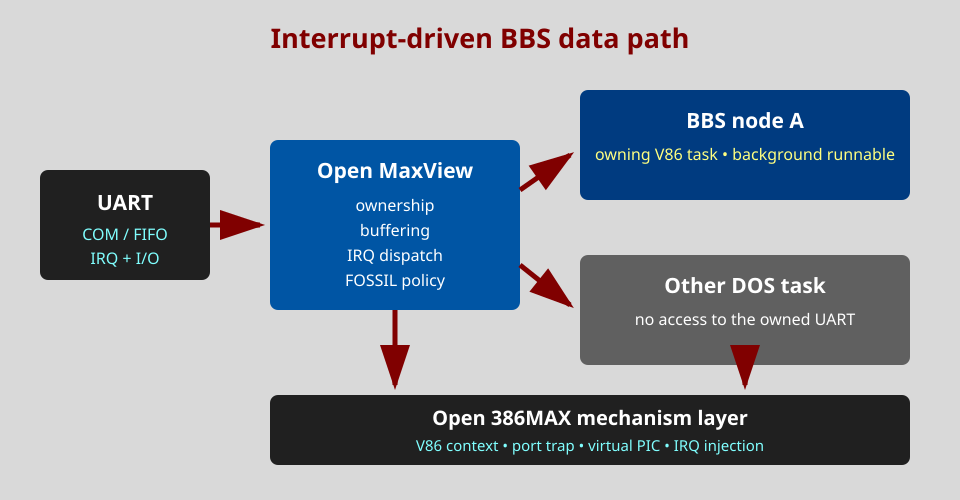

# Serial and BBS design guide

This guide defines the Open MaxView 1.x requirements for DOS bulletin-board
systems and communications programs.

## What works today

Measured side by side with DESQview 2.80 on Open 386MAX (QEMU, tests/SERPRB
as an interrupt-driven node that echoes every byte):

* **Several nodes at once.** Each task that hooks a COM port's IRQ vector
  gets that IRQ in its own context, in front or in the background. Two
  nodes on COM1 (IRQ4) and COM2 (IRQ3) with a third task running and the
  foreground switched during the transfer lose no byte, at 100 bytes a
  second and at 960 (9600 baud, an IRQ per byte, no FIFO), 30000 bytes each
  (mvtest `nodes`); DESQview 2.80 gives the same result (local script
  `build/dvdbg/dser.sh`).
* **Two tasks on the same port.** DESQview 2.80 does not refuse it: the
  window that hooked the IRQ last gets it, even while the other one is in
  front (measured: after the second window started, the first received
  nothing more, also when switched back to the front). The multitasking
  core does the same (`irqown`: a task's newly hooked IRQ1-7 vectors are
  noted when its IVT is saved; the current task wins while it hooks one
  anew; a task's IRQs are forgotten when it ends) (mvtest `samecom`).
* Programs using BIOS `INT 14h` polling need nothing special. A FOSSIL
  driver loaded before MaxView is shared by all tasks, as under DESQview:
  its IRQ handler stays in every task's IVT unless a task hooks the vector
  itself.

Not done yet: UART I/O trapping and per-port ownership (DESQview has none
either), a FOSSIL test with a real driver, and shared-IRQ dispatch of two
UARTs on one line to two tasks (QEMU's ISA bus cannot share an IRQ line,
so this needs real hardware).



## Required program models

Open MaxView must support three declared access modes:

1. **BIOS** intercepts standard DOS BIOS serial calls through `INT 14h`.
2. **UART** traps direct I/O to the configured UART and routes its IRQ to the
   owning V86 task.
3. **FOSSIL** supports the common `INT 14h` driver interface, including
   nonblocking transmit, status, purge, flow control, block I/O and driver
   information.

Detection may recommend a mode but must not guess ownership of a live port.

## Ports, UARTs and IRQs

Traditional defaults are:

| Port | Base address | IRQ |
|---|---:|---:|
| COM1 | `03F8h` | 4 |
| COM2 | `02F8h` | 3 |
| COM3 | commonly `03E8h` | often 4 |
| COM4 | commonly `02E8h` | often 3 |

COM3 and COM4 have no universal assignment. Configuration stores both the
base and IRQ and permits probing to be disabled. A 16550-compatible FIFO is
preferred at high baud rates, but correctness with an 8250/16450 single-byte
receiver is required.

## Ownership and shared IRQs

DESQview 2.80 has no port ownership: the window that hooked an IRQ last gets
it, and MaxView behaves the same by default (see above). An optional check
may later warn when a second task opens a port already in use; it must not
change the DESQview-compatible default. Sharing a port between tasks is only
safe through a provider that multiplexes complete logical connections.

Two distinct UARTs may share an IRQ. The host dispatcher must poll every UART
registered on that line until none reports pending work. Assigning two ports
the same IRQ does not make their application handlers automatically safe.

Carrier, DTR, RTS, break and flow-control state belong to the logical owner.
Closing or killing a node applies its configured hang-up policy before the
context is destroyed.

## Scheduling

An active node is background runnable and pinned against swap-out. Receive
activity may wake it before its next ordinary slice. Hardware handlers have a
bounded budget; protocol parsing and disk writes run in normal task time.

The scheduler records queue watermarks, pending work, time since last run,
foreground/background weights, overruns, framing errors and dropped bytes.
Serial priority must not starve timer, disk, keyboard or another line.

## Open 386MAX boundary

Open 386MAX provides only the mechanisms required by Open MaxView:

* isolated V86 context creation and destruction;
* trapping a declared I/O-port range;
* saved virtual PIC and interrupt-enable state;
* virtual IRQ injection into a selected context;
* wake-up from a host hardware interrupt;
* monotonic event counters for diagnostics.

Open MaxView owns UART emulation, FOSSIL calls, buffering, port assignment,
hang-up and scheduling policy. Serial and networking policy never moves into
Open 386MAX.

## 1.x descriptor fields

```text
SERIAL_MODE=NONE|BIOS|UART|FOSSIL
SERIAL_PORT=1..4|CUSTOM
SERIAL_BASE=hex-address
SERIAL_IRQ=0..15
SERIAL_BACKGROUND=YES|NO
SERIAL_PINNED=YES|NO
SERIAL_SHARED_PROVIDER=name-or-empty
SERIAL_HANGUP=KEEP|DROP_DTR|COMMAND
```

Imported DVP serial flags are migration hints, never proof of the actual base,
IRQ or safe sharing mode. The editor exposes these settings only when backend
I/O trapping and IRQ injection are available.

## Planned MAXVSER tool

`MAXVSER.EXE` will use the common 386MAX-style interface and display base,
IRQ, UART/FIFO type, owner task, carrier, queue use and error counters.
Planned script modes are:

```text
MAXVSER /LIST
MAXVSER /CHECK
MAXVSER /PROBE /PORT:1
```

Probe is read-only by default and refuses a port owned by a running task.

## BBS deployment profile

For each node:

1. assign a unique UART or multiplexed endpoint;
2. select its real BIOS, UART or FOSSIL access model;
3. enable background execution and pin the active node;
4. reserve memory for the BBS and external transfer protocols;
5. define carrier-loss and forced-close behaviour;
6. test sustained traffic while switching and hiding other tasks;
7. verify counters and ensure no unmediated ownership conflict exists.

## Acceptance tests

Serial/BBS support is ready only after tests demonstrate:

* continuous full-duplex transfer on COM1 and COM2 while switching tasks;
* matching streams from direct-UART and FOSSIL clients;
* correct shared-IRQ dispatch for two UARTs;
* no receive loss during documented foreground disk loads;
* carrier loss, DTR hang-up and forced-close cleanup;
* rejection of conflicting ownership;
* correct single-byte and FIFO UART operation;
* stable counters after injected overruns;
* a multi-node BBS soak test lasting several hours.

Until then, serial fields remain retained migration data rather than a runtime
compatibility claim.

